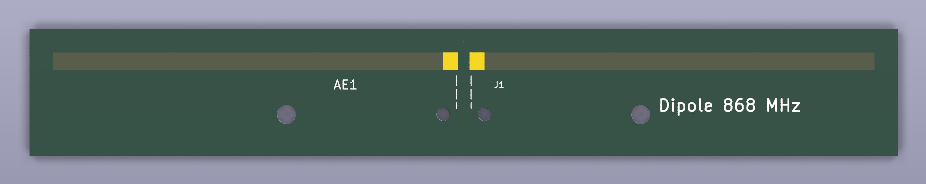
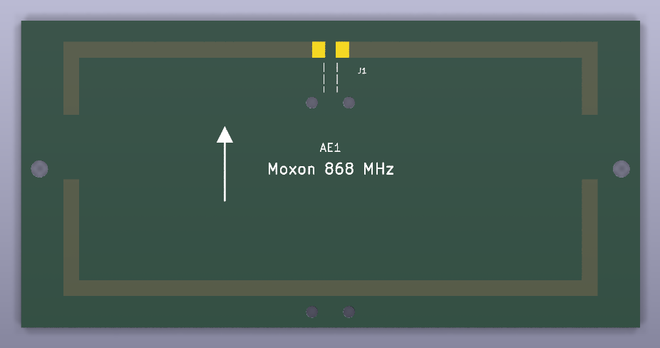

# Antennas

Printed PCB antennas, designed as code and checked by simulation. One directory per antenna type,
each with its simulation scripts, the KiCad project, etching masks and a `STATUS.md`.
Single-sided boards without parts except the coax: home etching (toner transfer) or any PCB maker.

| Antenna | Type | Band | Simulated on 1.6 mm FR4 | Board |
|---|---|---|---|---|
| [dipole-868](dipole-868/) | Half-wave dipole, reference antenna | LoRa / EU868 | 2.0 dBi, SWR < 1.3 | 147 x 22 mm |
| [moxon-868](moxon-868/) | Moxon rectangle, directional | LoRa / EU868 | 5.3 dBi, F/B 13-14 dB, SWR < 1.2 | 117 x 58 mm |

| dipole-868 | moxon-868 |
|---|---|
|  |  |

> **Status: simulated, not yet measured.** The numbers above come from NEC2 and openEMS simulations.
> The boards have not been built and measured yet; real FR4 (er 4.2-4.7) can move the frequency by
> a few percent. Results of RSSI measurements will be added here.

## How these antennas were made

The antennas were designed together with an LLM: **Claude (Anthropic), working in
[Claude Code](https://claude.com/claude-code)** on the author's machine. The author set the goals
(band, gain, directivity, size, home etching, no VNA available for tuning) and made the decisions;
Claude chose the antenna types together with the author, wrote all scripts in this repository, ran the
simulations and interpreted the results. Nothing was taken from an existing antenna design file.

The workflow, per antenna:

1. **Free-space design with NEC2** (`sim.py`, nec2c, the C port of NEC2): wire model,
   optimises the dimensions for match, gain and front/back ratio in the band.
2. **Check and tuning on FR4 with FDTD** (`sim_fdtd.py`, [openEMS](https://openems.de) with its CSXCAD
   Python interface): NEC2 cannot model the substrate, so the printed strips on 1.6 mm FR4 are simulated
   in 3D, including the dielectric losses. For the Moxon a parameter sweep plus a Nelder-Mead
   optimisation ([SciPy](https://scipy.org)) found the board dimensions.
3. **Circuit as code** (`board.py`, [SKiDL](https://github.com/devbisme/skidl)): antenna and coax feed as
   a netlist.
4. **Readable schematic** (`schematic.py`,
   [kicad-schematic-builder](https://github.com/movray/kicad-schematic-builder)): draws the KiCad schematic
   from the netlist and checks that both agree.
5. **PCB with the KiCad 9 pcbnew Python API** (`layout.py`): writes the antenna footprint from the simulated
   dimensions, places it, adds outline and holes, runs the DRC with `kicad-cli` and writes the etching masks.

Because every step is a script, a change in the simulation flows through to the board by re-running
the scripts; nothing was drawn by hand.

### Lessons learned

* Strips on one side of 1.6 mm FR4 get about **14 % shorter** than in free space (`K_FR4 = 0.86`,
  openEMS, dipole resonant at 868.7 MHz), not the ~5 % that is often assumed.
* Antennas with coupled elements (Moxon, Yagi) **do not just scale** with that factor: the substrate also
  changes the coupling between the elements. The NEC design x 0.86 gave only 7 dB front/back on FR4.
  They have to be tuned in a simulator that models the substrate.
* On FR4 the printed Moxon reaches about 14.5 dB front/back at best (in free space > 25 dB). If you need more,
  build it from wire on a plastic frame; then the NEC2 dimensions apply directly.
* openEMS: simulating only one half of a mirror-symmetric antenna with a PEC wall gives the same result
  (checked against the full model) in about 1/10 of the time.

## Tools to re-run

* nec2c (Debian/Ubuntu package `nec2c`)
* openEMS and CSXCAD with their Python modules (built from source,
  [openEMS-Project](https://github.com/thliebig/openEMS-Project)), plus numpy, scipy, h5py
* KiCad 9 (its Python `pcbnew` module, `kicad-cli`)
* SKiDL and kicad-schematic-builder for the schematic

The `Regenerate` section in each antenna's README lists the commands.

## License

* Hardware (KiCad projects, footprints, etching masks, dimensions, documentation):
  [CERN-OHL-P-2.0](LICENSES/CERN-OHL-P-2.0.txt)
* Scripts (`*.py`): [MIT](LICENSES/MIT.txt)

See [LICENSE](LICENSE). Use, modify, build and sell freely; keep the copyright notice.
No warranty: these are simulated designs, check them before you rely on them.
