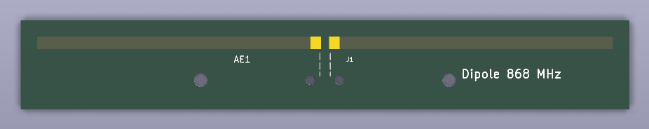

# dipole-868



Printed half-wave dipole for LoRa 868 MHz. It is the reference antenna (2.15 dBi by definition) for
comparing the Moxon (`../moxon-868`) and bought antennas with RSSI measurements, and it is a usable
omnidirectional antenna in its own right (in the plane at right angles to the dipole).
Single-sided, no parts except the coax: home etching or JLCPCB.

## Files

| File | Purpose |
|---|---|
| `sim.py` | NEC2 model (nec2c), finds the resonant length for 868 MHz, writes `dipole-868-dims.json` |
| `sim_fdtd.py` | openEMS (FDTD) check of the board dimensions on FR4, prints the corrected `K_FR4` |
| `dipole-868-dims.json` | Simulated length: free space and on FR4 (input for `layout.py`) |
| `board.py` | Circuit (SKiDL): antenna AE1 and coax feed J1 |
| `schematic.py` | Draws the schematic with [kicad-schematic-builder](https://github.com/movray/kicad-schematic-builder) and checks it against the netlist |
| `dipole-868.kicad_sch` | Generated schematic |
| `layout.py` | Writes the antenna and feed footprints from the length, builds the PCB, DRC, etching masks |
| `dipole-868.pretty/` | Generated footprints `Dipole_868` and `CoaxFeed_Gap2mm` |
| `dipole-868.kicad_pcb` | Generated PCB (open in KiCad) |
| `dipole-868-etch-mirrored.pdf` | Etching mask for toner transfer (mirrored, 1:1 on A4) |
| `dipole-868-etch-topview.pdf` | Same mask unmirrored, as seen from the copper side (for checking) |

## Regenerate

```bash
/usr/bin/python3 sim.py          # NEC2 -> dipole-868-dims.json (needs nec2c on the PATH, see ../moxon-868)
~/.venvs/openems/bin/python sim_fdtd.py   # optional: openEMS check on FR4 (~1 min)
python board.py                  # circuit -> netlist (runs SKiDL ERC; Python with skidl)
python schematic.py              # netlist -> schematic, fails if the connectivity differs
kicad-cli sch erc dipole-868.kicad_sch
/usr/bin/python3 layout.py       # dims + schematic netlist -> footprints + PCB, DRC, etching masks
```

## Antenna

Total length 161.7 mm in free space (NEC2), **139.0 mm** on FR4 including the 2 mm feed gap.
Copper strip 3 mm wide, board 147 x 22 mm.

The FR4 shortens the dipole by 14 %, much more than the usual rule of thumb: openEMS (`sim_fdtd.py`,
1.6 mm FR4, er 4.4, tan d 0.02) puts the resonance of the free-space length scaled by 0.95 at 792 MHz.
With `K_FR4 = 0.86` it is at 868.7 MHz. Mesh check: twice as fine a mesh moves it by 0.7 %.
Without the substrate openEMS and NEC2 agree within 1.3 %.

openEMS on FR4 (board dimensions):

| f / MHz | Z / Ohm | SWR (50 Ohm) |
|---|---|---|
| 850 | 56 - 12j | 1.28 |
| 863 | 59 - 4j | 1.20 |
| 868 | 61 - 1j | 1.21 |
| 870 | 61 + 1j | 1.22 |
| 890 | 67 + 14j | 1.46 |

Gain at 868 MHz 1.96 dBi (directivity 2.07 dBi, FR4 and copper losses 0.1 dB).
The er of FR4 varies between makers (4.2-4.7); this moves the resonance by about +-2 %.

## Feed

Same as the Moxon: RG316 / RG174 pigtail with SMA at the other end, centre conductor to the **left** pad,
shield to the **right** pad, the cable leaves at right angles to the dipole and is held by a cable tie
through the 2.2 mm hole pair. M3 holes: nylon screws.

## Etching (toner transfer)

Print `dipole-868-etch-mirrored.pdf` on a laser printer at **100 % / actual size** and check the size:
the outline is 162 x 22 mm.
