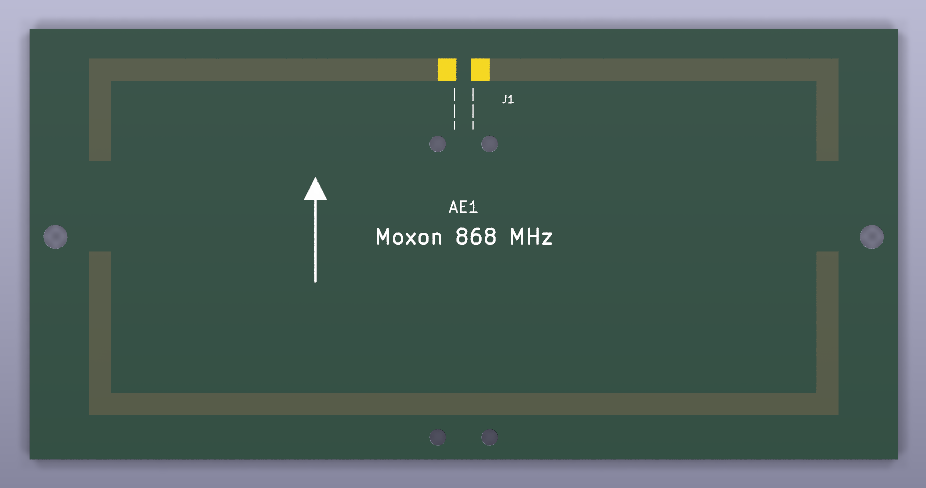

# moxon-868



Directional PCB antenna for LoRa 868 MHz: a Moxon rectangle printed on FR4.
On 1.6 mm FR4 (openEMS): about 5.3 dBi and 13-14 dB front/back ratio in the EU868 band, SWR < 1.2
at 50 Ohm without a matching network. Single-sided, no parts except the coax: home etching or JLCPCB.

Compared to a typical cheap SMA stub antenna (real gain often around 0 dBi) that is about 5 dB more in the
beam direction - roughly 1.8 x the range - and signals from behind are ~25 x weaker.

## Files

| File | Purpose |
|---|---|
| `sim.py` | NEC2 model (nec2c), free-space design for 868 MHz, writes `moxon-868-dims.json` |
| `sim_fdtd.py` | openEMS (FDTD) model on FR4: sweep and optimisation of the board dimensions (`board_mm`) |
| `STATUS.md` | How the FR4 dimensions were found, all simulation results |
| `moxon-868-dims.json` | Simulated dimensions: free space and on FR4 (input for `layout.py`) |
| `board.py` | Circuit (SKiDL): antenna AE1 and coax feed J1 |
| `schematic.py` | Draws the schematic with [kicad-schematic-builder](https://github.com/movray/kicad-schematic-builder) and checks it against the netlist |
| `moxon-868.kicad_sch` | Generated schematic |
| `layout.py` | Writes the antenna and feed footprints from the dimensions, builds the PCB, DRC, etching masks |
| `moxon-868.pretty/` | Generated footprints `Moxon_868` and `CoaxFeed_Gap2mm` |
| `moxon-868.kicad_pcb` | Generated PCB (open in KiCad) |
| `moxon-868-etch-mirrored.pdf` | Etching mask for toner transfer (mirrored, 1:1 on A4) |
| `moxon-868-etch-topview.pdf` | Same mask unmirrored, as seen from the copper side (for checking) |

## Regenerate

```bash
/usr/bin/python3 sim.py          # NEC2 optimisation -> moxon-868-dims.json (needs nec2c on the PATH)
~/.venvs/openems/bin/python sim_fdtd.py --sweep            # FR4: grid search (~30 min, 2 runs x 4 threads)
~/.venvs/openems/bin/python sim_fdtd.py --optimize s,C,r   # FR4: tune, writes board_mm
python board.py                  # circuit -> netlist (runs SKiDL ERC; Python with skidl)
python schematic.py              # netlist -> schematic, fails if the connectivity differs
kicad-cli sch erc moxon-868.kicad_sch
/usr/bin/python3 layout.py       # dims + schematic netlist -> footprints + PCB, DRC, etching masks
```

`~/.venvs/openems` is a Python venv with the openEMS / CSXCAD modules; `/usr/bin/python3` is used where
KiCad's `pcbnew` module is needed. Without root, nec2c can be unpacked from the Debian package
(`apt-get download nec2c && dpkg -x nec2c_*.deb ~/.local/opt/nec2c`) and linked into the PATH.

## Antenna

```
        <---------------- A ---------------->
        +----------------+  +---------------+     driven element, feed gap 2 mm in the middle
        |               J1 (coax pads)      |     tails B
        |                 :                 |
                          :  coax                 gap C
        |                 :                 |     tails D
        +-----------------:-----------------+     reflector
                          :
                      to SMA                       beam -> up (towards the driven element)
```

| Dimension | Free space (NEC) | On FR4 (openEMS) |
|---|---|---|
| A (width, strip centre lines) | 123.3 mm | 98.1 mm |
| B (driven element tails) | 15.5 mm | 12.3 mm |
| C (gap between the tails) | 7.1 mm | 12.2 mm |
| D (reflector tails) | 23.6 mm | 20.6 mm |
| E (depth = B + C + D) | 46.2 mm | 45.1 mm |

Copper strips 3 mm wide, board 117 x 58 mm.

The FR4 dimensions do **not** follow from the free-space ones by one factor: the substrate shortens
the strips by ~14 % and also changes the coupling across the gap C. They were tuned directly in openEMS
(1.6 mm FR4, er 4.4, tan d 0.02): A, B, D x 0.86 x 0.925, the reflector tails D another x 1.094, and C
12.2 mm. See `STATUS.md`.

openEMS on FR4, at 50 Ohm:

| f / MHz | SWR | Gain / dBi | F/B / dB |
|---|---|---|---|
| 850 | 1.67 | 5.4 | 11 |
| 860 | 1.18 | 5.3 | 13 |
| 870 | 1.13 | 5.2 | 14 |
| 880 | 1.35 | 5.1 | 15 |
| 900 | 1.62 | 4.8 | 13 |

On FR4 the front/back ratio peaks at ~14.5 dB (NEC in free space: > 25 dB); this is the best the
printed version reaches. A Moxon from 2 mm copper wire on a plastic frame would reach the NEC values.
If a measurement shows that the antenna works best at another frequency, scale A, B, C, D by
868 / f_best.

Polarisation is in the board plane: for LoRa nodes with vertical whips, mount the board **vertically**
(elements vertical), beam pointing at the counter station.

## Feed

J1 are two solder pads on the feed gap. Use a 50 Ohm pigtail RG316 (or RG174) with an SMA socket at the
other end (e.g. "SMA female bulkhead RG316 15 cm"):

* centre conductor to the **left** pad (pad 1), shield to the **right** pad (pad 2), keep the unshielded
  part as short as possible (< 3 mm)
* the cable runs straight down along the centre line, across the reflector, at right angles to the elements;
  two cable ties through the 2.2 mm hole pairs hold it there
* optional: a clip-on ferrite or a few ferrite beads on the cable right behind the reflector
  (stops currents on the cable shield)

M3 holes left and right: use nylon screws and keep metal away from the tails.

## Etching (toner transfer)

`layout.py` writes the masks after a clean DRC: copper black, board outline as cutting line, the holes
left open as drill marks. Print `moxon-868-etch-mirrored.pdf` on a laser printer at **100 % / actual size**
and check the size: the outline is 117 x 58 mm. For JLCPCB: 1.6 mm FR4, 1 oz, any colour; the solder mask
covers the antenna, only the J1 pads are open.

## Testing without a VNA

Two LoRa modules (e.g. RFM95 / SX1276 / SX1262 on a microcontroller): one sends packets at a fixed spot,
the other logs RSSI and SNR at a distance (> 10 m, outdoors or in a long corridor). Swap only the
antenna on the receiver:

* gain: Moxon pointed at the sender vs. the reference dipole (`../dipole-868`, 2.15 dBi) vs. the bought antenna
* front/back: Moxon pointed at the sender vs. turned by 180 deg - about 10-14 dB expected (multipath indoors
  makes it less)
* average several readings per position; a single RSSI value scatters by a few dB
